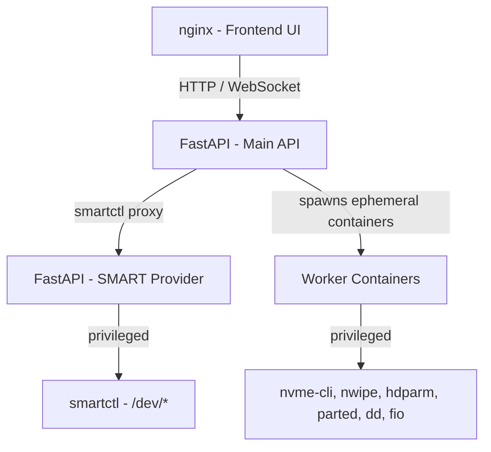

import DocCardList from '@theme/DocCardList';
import { useCurrentSidebarCategory } from '@docusaurus/plugin-content-docs/client';

export const DocList = () => {
  const category = useCurrentSidebarCategory();
  return (
    <DocCardList items={category.items.filter(item => item.label !== 'Disk Hunter' && item.label !== 'Disk-Hunter')} />
  );
};

# Disk Hunter

An all-in-one web utility for testing, managing, wiping, and formatting physical storage drives.

**Repository:** [Mat-Ice-QC/Disk-Hunter](https://github.com/Mat-Ice-QC/Disk-Hunter)

## Overview

Disk Hunter provides a glassmorphic web dashboard for administrative disk operations. A Python FastAPI backend orchestrates root-level commands inside ephemeral privileged Docker containers, keeping the host system isolated from destructive storage operations.

## Documentation Sections

<DocList />

## Key Features

- **Interactive Dashboard** - Drives, partitions, health metrics, form-factor badges (`U.2`, `U.3`), and hardware specifications in a unified grid with lightbox inspection.
- **Secure Wiping (Shredder)** - Block-level erasure via `nwipe` (DoD Short, DoD Full, Gutmann, PRNG Stream, Fill Zeros), ATA Secure Erase via `hdparm`, and hardware-level NVMe Secure Erase (`nvme-cli` User Data and Cryptographic Format) with automated PDF Certificate of Erasure generation.
- **ATA Frozen Drive Handling** - Multi-method unfreeze workflows with configurable NIST SP 800-88 Clear zero-overwrite fallback (`FROZEN_FALLBACK_WIPE`).
- **S.M.A.R.T. Diagnostics** - Short and extended self-tests, live progress polling, self-test log inspection, and parsed health attribute tables including NVMe, U.2, and U.3 drives.
- **Speed Benchmarks** - Sequential read, write, and read/write benchmarks powered by `fio` across 1 GB, 10 GB, and 100 GB test sizes with historical tracking.
- **Visual Partition Editor** - Create, delete, and format partitions (`ext4`, `ext3`, `ext2`, `ntfs`, `fat32`, `fat16`, `btrfs`, `xfs`) across GPT, MBR/MSDOS, and specialized partition tables using `parted`.
- **ISO Downloader and Writer** - Download `.iso` or `.img` OS images to `/app/data/isos` and flash them to target block devices, recording every action in `iso_history.json`.
- **Temperature Monitoring** - Multi-sensor temperature view with configurable server-side warning/critical thresholds and sensor selection.
- **Network Configuration Page** - Inspect interfaces, default gateway, and DNS at `network.html`; validate static, DHCP, and 802.1Q VLAN plans and generate netplan YAML. Host apply is disabled by default (`NETWORK_APPLY_ENABLED=false`) and guarded by an automatic rollback timer when enabled.
- **Host Power Controls** - **Shut Down Host** and **Reboot Host** buttons on the dashboard next to Rescan Hardware; protected by confirmation dialogs, refused while any disk operation is running, and executed by a privileged `--pid=host` worker container (`disk-hunter-power`) via the host's `systemd` (`nsenter`), gated by `POWER_ACTIONS_ENABLED` (default `true`).
- **Kiosk Mode** - Optional Firefox ESR fullscreen kiosk container running on host `tty2` for bare, air-gapped Linux appliances without a desktop environment.
- **Notifications and Inventory Mapping** - Centralized notifications feed with unread banner alerts, plus serial-number-to-Inventory-ID mapping (`/api/inventory`) integrated into history tables, CSV exports, and erasure certificates.
- **Onboard Help and Glassmorphic UI** - Modular in-app Markdown documentation with localized translations, dark glassmorphic styling, custom modals, and a low-overhead Potato Mode for resource-constrained hardware.

## High-Level Architecture

| Component | Container | Role | Communicates With |
| --- | --- | --- | --- |
| **Frontend UI** | `disk-hunter-ui` (`nginx:alpine`) | Serves the static HTML/CSS/JS web interface and proxies API/WebSocket traffic | Polls status and invokes the Main API |
| **Main API** | `disk-hunter-api` (`Python FastAPI`) | Orchestration hub managing state, history, PDF reports, and worker lifecycles | Spawns/monitors ephemeral worker containers; delegates SMART queries |
| **SMART Provider** | `disk-hunter-smart-provider` (`Python FastAPI`) | Privileged microservice acting as a `smartctl` proxy with a 30-second cache | Executes privileged `smartctl` commands against `/dev/*` |
| **Worker Containers** | `disk-hunter-*` | Ephemeral sandboxed execution environments for single-purpose tasks | Runs `nvme-cli`, `nwipe`, `hdparm`, `parted`, `dd`, `fio`, `smartctl`, `nsenter`/`systemctl` (`power`), and `firefox-esr` |

All container base images are pinned by SHA256 digest and APK/pip packages are version-locked to prevent upstream tag drift.

## Recent Updates

- **2026-11-15** - Host power controls (issue #4): **Shut Down Host** and **Reboot Host** buttons on the dashboard with confirmation dialogs, busy-disk refusal, WebSocket broadcast notices to all connected clients, automatic button unlock on WebSocket reconnection (`ws-open`) after a reboot, EN/FR/ES localization keys, a digest-pinned `disk-hunter-power` worker (`--pid=host`, graceful `systemd` `poweroff`/`reboot` via `nsenter` with fallbacks), and the `POWER_ACTIONS_ENABLED` gate (default `true`).
- **2026-10-22** - UI performance optimization pass and Settings card text reflow fixes: keyed DOM caching for drive cards, zero-mutation idle WebSocket ticks, delegated event listeners across tables and grids, immutable default drive SVGs (`/api/images/defaults/{kind}.svg`), on-demand directory size calculation (`/api/data-management/dir-size`) with TTL caching, `localStorage` stale-while-revalidate for UI chrome/locales, and removal of full-viewport modal backdrop blur.
- **2026-10-21** - Feature batch: image delete buttons and cache-busting in the Drive Image Manager; link-up/DHCP/DNS fixes on network apply (`isc-dhcp-client` and `ntpdate` added to the API image); system time view/set plus NTP sync in Settings; ATA Secure Erase capability-check fix; cross-module busy-disk locking with `BUSY` cards across operation pages; `nwipe` failure log persistence and problematic disk flagging; S/N to Inventory ID mapping (`/api/inventory`) across history tables, CSV exports, and PDF certificates; S.M.A.R.T. self-test log modal; per-folder sizes, read-only-safe file browsing, and root-usage indicator; consistent multi-temperature badges; Notifications page with unread badge and global banner.
- **2026-10-15** - 802.1Q VLAN sub-interfaces on the Network page (parent interface unmodified; `POST /api/network/vlan/remove` with gate and rollback); Network page (`network.html`) with `NETWORK_APPLY_ENABLED` gate and automatic rollback timer; `backend/docker-entrypoint.sh` for safe `755`/`644` first-start permissions; Phase 1 fixes (NVMe/U.2/U.3 S.M.A.R.T. parsing, unified serial lookup, `NO TABLE` badge, `.iso` auto-append and download history, persistent shredding selection across mode switches, bulk metadata assignment in the Confirm Data Destruction modal, server-wide `Generate Cert` setting in `app_settings.json`, unified history columns and command-detail modal).
- **2026-09** - Multi-method ATA frozen drive unfreeze, NVMe secure erase with user-data fallback, security audit hardening (server-side drive validation, path traversal and command-injection guards, root-disk protection), multi-sensor temperature page, and supply-chain digest pinning.

## Roadmap / Planned Items

- Active Directory / LDAP (`SSSD`, `Kerberos`) authentication for the portable boot environment
- Disk and partition cloning module (`partclone` / Clonezilla)
- Drive array / ZFS management module (`zpool` / `zfs`)
- Automated SMTP emailing of PDF erasure certificates
- Bulk firmware updates across uniform drive batches
- Network share / disk browsing module implementation
- Debian APT package version pinning across Debian-based worker images
- API endpoint authentication
