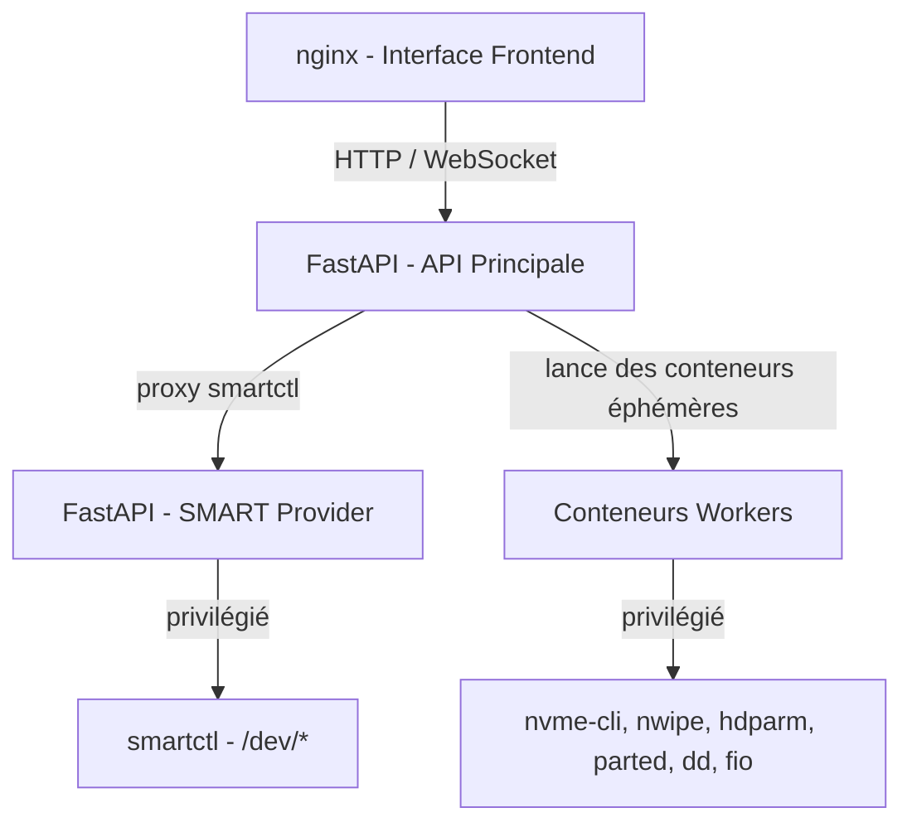

import DocCardList from '@theme/DocCardList';
import { useCurrentSidebarCategory } from '@docusaurus/plugin-content-docs/client';

export const DocList = () => {
  const category = useCurrentSidebarCategory();
  return (
    <DocCardList items={category.items.filter(item => item.label !== 'Disk Hunter' && item.label !== 'Disk-Hunter')} />
  );
};

# Disk Hunter

Un utilitaire web tout-en-un conçu pour tester, gérer, effacer et formater des disques de stockage physiques.

**Dépôt :** [Mat-Ice-QC/Disk-Hunter](https://github.com/Mat-Ice-QC/Disk-Hunter)

## Aperçu

Disk Hunter propose une interface web au design glassmorphique pour les opérations d'administration de disques. Un backend Python FastAPI orchestre les commandes privilégiées de niveau root à l'intérieur de conteneurs Docker éphémères isolés, protégeant ainsi le système hôte contre les opérations de stockage destructrices.

## Sections de la documentation

<DocList />

## Fonctionnalités principales

- **Tableau de bord interactif** - Visualisation des disques connectés, des structures de partitions, de l'état de santé, des badges de facteur de forme (`U.2`, `U.3`) et des spécifications matérielles dans une grille unifiée avec aperçu agrandi (lightbox).
- **Effacement sécurisé (Shredder)** - Effacement par écrasement de blocs via `nwipe` (DoD Court, DoD Complet, Gutmann, Flux PRNG, Remplir de zéros), ATA Secure Erase via `hdparm` et effacement sécurisé matériel NVMe (`nvme-cli`, formatage des données utilisateur et formatage cryptographique) avec génération automatique d'un certificat d'effacement PDF.
- **Gestion des disques ATA gelés (Frozen)** - Procédures de dégel multi-méthodes avec repli configurable vers un écrasement par zéros conforme à la norme NIST SP 800-88 Clear (`FROZEN_FALLBACK_WIPE`).
- **Diagnostics S.M.A.R.T.** - Autotests courts et étendus, suivi de la progression en direct, consultation du journal d'autotests et tableaux d'attributs de santé analysés, y compris pour les disques NVMe, U.2 et U.3.
- **Tests de performance (Speed Benchmarks)** - Tests séquentiels de lecture, d'écriture et bidirectionnels basés sur `fio` avec des tailles de blocs de 1 Go, 10 Go et 100 Go et historique des résultats.
- **Éditeur de partitions visuel** - Création, suppression et formatage de partitions (`ext4`, `ext3`, `ext2`, `ntfs`, `fat32`, `fat16`, `btrfs`, `xfs`) sur tables GPT, MBR/MSDOS et architectures spécialisées via `parted`.
- **Téléchargeur et flasheur d'images ISO** - Téléchargement d'images OS `.iso` ou `.img` dans `/app/data/isos` et écriture directe sur les périphériques de bloc cibles, chaque opération étant consignée dans `iso_history.json`.
- **Surveillance des températures** - Page multi-capteurs avec seuils d'avertissement/critiques et sélection des capteurs persistés côté serveur.
- **Page de configuration réseau** - Inspection des interfaces, de la passerelle par défaut et du DNS sur `network.html` ; validation de plans statiques, DHCP et sous-interfaces VLAN 802.1Q avec génération du YAML netplan. L'application sur l'hôte est désactivée par défaut (`NETWORK_APPLY_ENABLED=false`) et protégée par un minuteur de restauration automatique lorsqu'elle est activée.
- **Marche/arrêt de l'hôte (Host Power Controls)** - Boutons **Arrêter l'hôte** et **Redémarrer l'hôte** sur le tableau de bord à côté de Rescanner le matériel ; protégés par une modale de confirmation, refusés tant que des opérations disque sont en cours, et exécutés par un conteneur worker privilégié `--pid=host` (`disk-hunter-power`) via `systemd` (`nsenter`), contrôlés par `POWER_ACTIONS_ENABLED` (`true` par défaut).
- **Mode Kiosque** - Conteneur optionnel Firefox ESR plein écran sur le terminal `tty2` de l'hôte pour les appliances Linux autonomes sans environnement de bureau.
- **Notifications et inventaire** - Centre de notifications centralisé avec bandeau d'alerte global et correspondance entre numéro de série (`S/N`) et ID d'inventaire (`/api/inventory`) intégrée aux historiques, exports CSV et certificats PDF.
- **Aide intégrée et interface glassmorphique** - Guides Markdown modulaires traduits, thème sombre glassmorphique, modales personnalisées et mode allégé (Potato Mode) pour le matériel peu puissant.

## Architecture générale

| Composant | Conteneur | Rôle | Communique avec |
| --- | --- | --- | --- |
| **Interface Frontend** | `disk-hunter-ui` (`nginx:alpine`) | Sert l'interface statique HTML/CSS/JS et relaie le trafic API/WebSocket | Interroge le statut et invoque l'API principale |
| **API Principale** | `disk-hunter-api` (`Python FastAPI`) | Hub d'orchestration gérant l'état, l'historique, les rapports PDF et le cycle de vie des workers | Lance/surveille les conteneurs workers éphémères ; délègue les requêtes SMART |
| **SMART Provider** | `disk-hunter-smart-provider` (`Python FastAPI`) | Microservice privilégié servant de proxy `smartctl` avec cache de 30 secondes | Exécute les commandes `smartctl` privilégiées sur `/dev/*` |
| **Conteneurs Workers** | `disk-hunter-*` | Environnements d'exécution éphémères isolés pour chaque tâche | Exécute `nvme-cli`, `nwipe`, `hdparm`, `parted`, `dd`, `fio`, `smartctl`, `nsenter`/`systemctl` (`power`) et `firefox-esr` |

Toutes les images de base Docker sont épinglées par condensat SHA256 et les paquets APK/pip sont verrouillés par version.

## Mises à jour récentes

- **2026-11-15** - Contrôles d'alimentation de l'hôte (issue #4) : boutons **Arrêter l'hôte** et **Redémarrer l'hôte** sur le tableau de bord avec modales de confirmation, refus en cas de disque occupé, notification WebSocket à tous les clients connectés, déverrouillage automatique des boutons à la reconnexion WebSocket (`ws-open`) après un redémarrage, chaînes EN/FR/ES, worker épinglé `disk-hunter-power` (`--pid=host`, arrêt/redémarrage propre via `systemd` et `nsenter` avec replis) et variable `POWER_ACTIONS_ENABLED` (`true` par défaut).
- **2026-10-22** - Optimisation des performances de l'interface et correction du retour à la ligne dans les cartes des Paramètres : mise en cache DOM indexée des cartes de disques, zéro mutation DOM lors des ticks WebSocket inactifs, délégation d'événements sur les grilles et tableaux d'historique, SVG par défaut immuables (`/api/images/defaults/{kind}.svg`), calcul à la demande de la taille des dossiers (`/api/data-management/dir-size`) avec cache TTL, chargement instantané via `localStorage` (stale-while-revalidate) et suppression du flou d'arrière-plan plein écran sur les modales.
- **2026-10-21** - Lot de fonctionnalités : suppression d'images et invalidation du cache dans le gestionnaire d'images de disques ; correctifs link-up/DHCP/DNS lors de l'application réseau (`isc-dhcp-client` et `ntpdate` ajoutés à l'image API) ; lecture/réglage de l'heure système et synchronisation NTP dans les Paramètres ; correctif de détection des capacités ATA Secure Erase ; verrouillage inter-modules des disques occupés avec badge `BUSY` ; persistance des journaux d'échec `nwipe` et signalement des disques problématiques ; correspondance S/N vers ID d'inventaire (`/api/inventory`) dans les historiques, exports CSV et certificats PDF ; modale de journal d'autotests S.M.A.R.T. ; taille par dossier, navigation sécurisée en lecture seule et indicateur d'utilisation de la partition racine ; badges multi-températures homogènes ; nouvelle page Notifications avec badge et bandeau global.
- **2026-10-15** - Sous-interfaces VLAN (802.1Q) sur la page Réseau (interface parente jamais modifiée ; `POST /api/network/vlan/remove` avec verrou et restauration) ; page Réseau (`network.html`) avec verrou `NETWORK_APPLY_ENABLED` et restauration automatique ; script `backend/docker-entrypoint.sh` initialisant les permissions `755`/`644` ; correctifs Phase 1 (analyse S.M.A.R.T. NVMe/U.2/U.3, résolution unifiée des numéros de série, badge `NO TABLE`, ajout automatique de `.iso` et historique ISO, conservation de la sélection lors du changement de mode de broyage, attribution en masse dans la modale de confirmation, paramètre serveur `Generate Cert` dans `app_settings.json`, colonnes d'historique unifiées et modale de détail des commandes).
- **2026-09** - Dégel multi-méthodes des disques ATA gelés, effacement sécurisé NVMe avec repli sur les données utilisateur, durcissement de sécurité (validation serveur des périphériques, protections contre la traversée de répertoires et l'injection d'arguments, protection du disque système), page température multi-capteurs et épinglage SHA256 de la chaîne d'approvisionnement.

## Feuille de route (TODO)

- Authentification Active Directory / LDAP (`SSSD`, `Kerberos`) pour l'environnement de démarrage portable
- Module de clonage de disques et de partitions (`partclone` / Clonezilla)
- Module de gestion de grappes / ZFS (`zpool` / `zfs`)
- Envoi automatisé par courriel SMTP des certificats d'effacement PDF
- Mises à jour de micrologiciel (firmware) en lot sur des séries de disques identiques
- Module de partage réseau et d'exploration de disques montés
- Épinglage des versions de paquets Debian APT dans les images basées sur Debian
- Authentification sur les points de terminaison de l'API
